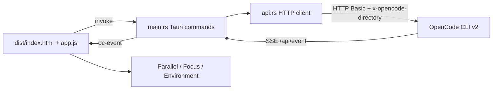

# MegaAGT

**English** · [Português (Brasil)](README.md)

   

## What it is

A desktop client for the OpenCode CLI v2. The CLI exposes its work through a local HTTP API and an SSE stream but has no graphical interface of its own. MegaAGT consumes that API and brings into one window parallel sessions, subagents, model reasoning, tool diffs, permission prompts, cost and tokens per session, and session export.

## Status

Working and in daily use on Windows. The app starts the OpenCode service by itself, connects with HTTP Basic over `service.json` and follows the SSE stream. There is no committed automated test suite; validation is manual, following the debugging notes in `CONTEXTO.md`.

## Features

**Sessions**

- List with search, multi-select (Ctrl + click), batch delete with confirmation, pin/unpin for Parallel and per-row delete.
- Collapsible sidebar (Ctrl + B), with persisted state.
- Subagent tree by `parentID`, with a total per session.
- Context ring in the header (green, warning at 70%, error at 90%) with a shortcut to compact.

**Composer**

- Message queue: while the model is busy, each item can be Cancelled or Steered (send now).
- Delivery mode: automatic, now or queued.
- Attachments by dragging files or folders (the server expands folders); in Parallel, dropping on a card attaches to it.
- Drafts per session and per card in `localStorage`.
- Camera that freezes auto-scroll, independent per session and per card.

**Focus (chat)**

- Markdown, reasoning and tools collapsed by default; long text truncated with "open to read".
- Agent and model switching through a searchable popover.
- Token statistics (input/output/reasoning/cache), cost, directory and session state.
- Actions: interrupt, compact, fork, revert to a message, move to another directory, file diff, export and delete.
- Inline permission prompts (Allow / Always / Deny) and slash commands with autocomplete.

**Parallel**

- Pinned sessions with live streaming and a message field per card.
- Model switch, context ring and interrupt button on each card.
- Reorder by the header and resize from the corner; size and order persist.

**Tools and events**

- Purpose-built rendering for `edit`/`patch` (unified diff, 3 context lines, +n/−n chips), `write`, `read`, `shell` and `grep`.
- SSE log with stream status, reconnect counter, type filter and pause.
- Effort/thinking from `none` to `max`, switching the model variant.
- Warnings for provider retries (429 or endpoint down), unhandled events and reasoning-only mode.

**Settings and environment**

- Four sections: OpenCode service, Appearance (9 themes, 6 accent colours, text size), Behaviour and Data.
- Environment tab: session context, MCP servers, saved permissions with revoke and configuration section names (never the values).
- In-session search with a match counter, a running-subagents panel and a collapsible compaction summary.

## Architecture

The Rust backend is a bridge: it reads `~/.local/state/opencode/service.json`, authenticates with HTTP Basic (`opencode:<password>`) and sends the working directory in the `x-opencode-directory` header. One task consumes the `/api/event` SSE and republishes each event as `oc-event` to the frontend. The "running" state is reconciled through `GET /api/session/active`, the authoritative source.



## Stack

- **Frontend**: vanilla JavaScript, no framework and no build step (`dist/app.js`, `dist/styles.css`, `dist/index.html`); `@tauri-apps/api` vendored in `dist/tauri-api/`.
- **Backend**: Rust with Tauri v2 — `src-tauri/src/main.rs` (commands and SSE event loop) and `src-tauri/src/api.rs` (HTTP client). Dependencies: `reqwest`, `tokio`, `serde`, `serde_json`, `futures-util`, `anyhow`, `base64`.
- **Runtime**: WebView2 on Windows 10/11.
- **Communication**: HTTP Basic + SSE against the local OpenCode service.

## Repository structure

```
MegaAGT/
├── dist/                     # vanilla JS frontend (app.js, styles.css, index.html)
│   └── tauri-api/            # vendored @tauri-apps/api
├── src-tauri/
│   ├── src/main.rs           # Tauri commands, SSE event loop, Windows helpers
│   ├── src/api.rs            # OpenCode HTTP client (service discovery and start)
│   ├── Cargo.toml            # megaagt package
│   ├── tauri.conf.json       # productName MegaAGT, identifier dev.opencode.hub
│   └── capabilities/default.json
├── app-icon.svg              # application icon
├── CONTEXTO.md               # maintenance: architecture, API contract, pitfalls, debugging
├── HERMES.md                 # unimplemented plan for a second tab with the Hermes Agent
├── package.json
└── package-lock.json
```

## Prerequisites and installation

- Windows 10/11 with WebView2
- Rust MSVC toolchain
- Node.js 18+
- OpenCode CLI v2 installed and on PATH

```bash
npm install
```

## How to run

Development:

```bash
npx tauri dev
```

Build:

```bash
npx tauri build
```

The executable is written to `src-tauri\target\release\megaagt.exe`. To copy it to the desktop, close the app first — the `.exe` is locked while running:

```powershell
Copy-Item src-tauri\target\release\megaagt.exe "$env:USERPROFILE\Desktop\MegaAGT.exe" -Force
```

After changing the icon: `npx tauri icon app-icon.svg`.

## Tests and quality

There is no automated test suite in the repository. Verification is manual: `npx tauri dev` starts the app, connects to the service and exercises the screens. `CONTEXTO.md` records the points that have already cost time and the CDP debugging notes for WebView2, along with the API contract pitfalls.

## Technical decisions and trade-offs

- **Vanilla JS frontend, no framework**: no build step; the whole app is three files that open in any editor.
- **Rust only as an HTTP bridge**: the entire presentation is JS and testable without recompiling; the most complex Rust command opens a folder.
- **Sorting on the client**: the API rejects `order` together with `cursor` (`InvalidCursorError`).
- **Actions only in the menu**: a header with six buttons becomes a wall.
- **Effort is the model variant**: that is how OpenCode models reasoning; there is no separate endpoint.
- **`rundll32` for external links**: avoids pulling the `shell-open` dependency tree.
- **Clip mask instead of a gradient**: an overlay always covers text; the mask sits in the empty padding.
- **Clickable folders with an explicit scanner**: pure regex errs both ways (cuts paths with spaces and swallows the neighbouring sentence).
- **SSE without timeout**: the server closes idle connections after about five seconds; fast reconnects are normal behaviour.

## Known limitations and roadmap

- Windows 10/11 with WebView2 only.
- Requires the OpenCode CLI v2 on PATH; the app calls `opencode service start`.
- npm installs have no `opencode.exe`, only `.cmd`/`.ps1` shims; Windows does not resolve shims when spawning, so the app looks for the real executable inside the CLI's `node_modules`.
- If `service.json` exists but the process died (after a reboot, for example), the read passes and the app only tries to reconnect; the user has to click start or open the CLI once.
- Above ~4 million cells (~2000 × 2000), the diff engine falls back to "remove everything / add everything" instead of running out of memory; at most 400 code lines are rendered per block.
- `GET /api/session?search=` matches content, not title.
- Models that answer HTTP 402 (insufficient funds) produce a transient error.
- Roadmap: a second tab with the Hermes Agent (plan in `HERMES.md`), not implemented yet.

## Development process

An individual project by Kelvin Oliveira, built with orchestrated AI agents and reviewed by the author. Interface decisions and integration pitfalls are recorded in `CONTEXTO.md`.

## License and author

MIT (the `LICENSE` file is not included in this repository).

**Author**: [Kelvin Oliveira](https://github.com/KelvinOliveiraCode) · [Portfolio](https://kelvinoliveiracode.github.io/portfolio/)
