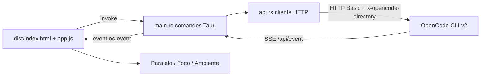

# MegaAGT

[English](README.en.md) · **Português (Brasil)**

   

## O que é

Cliente desktop para o OpenCode CLI v2. O CLI expõe o trabalho por uma API HTTP local e um stream SSE, mas não tem interface gráfica própria. O MegaAGT consome essa API e reúne em uma janela as sessões em paralelo, os subagentes, o raciocínio do modelo, os diffs de ferramentas, os pedidos de permissão, custo e tokens por sessão, e a exportação de sessões.

## Status

Funcional e em uso no Windows. O app sobe o serviço do OpenCode sozinho, conecta por HTTP Basic sobre `service.json` e acompanha o stream SSE. Não há suíte de testes automatizados versionada; a validação é manual, com o roteiro de depuração descrito em `CONTEXTO.md`.

## Funcionalidades

**Sessões**

- Lista com busca, seleção múltipla (Ctrl + clique), exclusão em lote com confirmação, fixar/desafixar para o Paralelo e excluir por linha.
- Barra lateral recolhível (Ctrl + B), com estado persistido.
- Árvore de subagentes por `parentID`, com total por sessão.
- Círculo de contexto no cabeçalho (verde, aviso em 70%, erro em 90%) com atalho para compactar.

**Compositor**

- Fila de mensagens: com o modelo ocupado, cada item pode ser Cancelar ou Steer (enviar agora).
- Modo de entrega: automático, agora ou na fila.
- Anexos por arrastar arquivos ou pastas (o servidor expande pastas); no Paralelo, soltar sobre um card anexa nele.
- Rascunhos por sessão e por card em `localStorage`.
- Câmera que trava a rolagem automática, independente por sessão e por card.

**Foco (chat)**

- Markdown, reasoning e ferramentas recolhidos por padrão; texto longo truncado com "abrir para ler".
- Troca de agente e de modelo por popover com busca.
- Estatísticas de entrada/saída/raciocínio/cache, custo, diretório e estado da sessão.
- Ações: interromper, compactar, bifurcar, reverter até uma mensagem, mover de diretório, diff de arquivos, exportar e excluir.
- Permissões na hora (Permitir / Sempre / Negar) e slash commands com autocompletar.

**Paralelo**

- Sessões fixadas com streaming ao vivo e campo de mensagem por card.
- Troca de modelo, círculo de contexto e botão de interromper em cada card.
- Reordenar pelo cabeçalho e redimensionar pelo canto; tamanho e ordem gravam.

**Ferramentas e eventos**

- Apresentação própria para `edit`/`patch` (diff unificado, 3 linhas de contexto, chips +n/−n), `write`, `read`, `shell` e `grep`.
- Log do stream SSE com status, contador de reconexões, filtro por tipo e pausa.
- Effort/thinking de `none` a `max`, trocando a variante do modelo.
- Avisos de nova tentativa do provedor (429 ou endpoint fora), eventos não tratados e modo só raciocínio.

**Ajustes e ambiente**

- Quatro seções: Serviço do OpenCode, Aparência (9 temas, 6 cores de destaque, tamanho do texto), Comportamento e Dados.
- Aba Ambiente: contexto da sessão, servidores MCP, permissões salvas com revogar e nomes de seção da configuração (nunca os valores).
- Busca dentro da sessão com contador, painel de subagentes rodando e resumo da compactação recolhível.

## Arquitetura

O backend Rust é uma ponte: lê `~/.local/state/opencode/service.json`, autentica com HTTP Basic (`opencode:<senha>`) e envia o diretório de trabalho no header `x-opencode-directory`. Uma tarefa consome o SSE `/api/event` e republica cada evento como `oc-event` para o frontend. O estado de "rodando" é reconciliado por `GET /api/session/active`, a fonte autoritativa.



## Stack

- **Frontend**: JavaScript puro, sem framework e sem build step (`dist/app.js`, `dist/styles.css`, `dist/index.html`); `@tauri-apps/api` vendorizado em `dist/tauri-api/`.
- **Backend**: Rust com Tauri v2 — `src-tauri/src/main.rs` (comandos e event loop SSE) e `src-tauri/src/api.rs` (cliente HTTP). Dependências: `reqwest`, `tokio`, `serde`, `serde_json`, `futures-util`, `anyhow`, `base64`.
- **Runtime**: WebView2 no Windows 10/11.
- **Comunicação**: HTTP Basic + SSE contra o serviço local do OpenCode.

## Estrutura do repositório

```
MegaAGT/
├── dist/                     # frontend vanilla JS (app.js, styles.css, index.html)
│   └── tauri-api/            # @tauri-apps/api vendorizado
├── src-tauri/
│   ├── src/main.rs           # comandos Tauri, event loop SSE, auxiliares do Windows
│   ├── src/api.rs            # cliente HTTP com o OpenCode (descoberta e início do serviço)
│   ├── Cargo.toml            # pacote megaagt
│   ├── tauri.conf.json       # productName MegaAGT, identifier dev.opencode.hub
│   └── capabilities/default.json
├── app-icon.svg              # ícone do aplicativo
├── CONTEXTO.md               # manutenção: arquitetura, contrato da API, armadilhas, depuração
├── HERMES.md                 # plano não implementado de segunda aba com o Hermes Agent
├── package.json
└── package-lock.json
```

## Pré-requisitos e instalação

- Windows 10/11 com WebView2
- Toolchain Rust MSVC
- Node.js 18+
- OpenCode CLI v2 instalado e no PATH

```bash
npm install
```

## Como executar

Desenvolvimento:

```bash
npx tauri dev
```

Build:

```bash
npx tauri build
```

O executável sai em `src-tauri\target\release\megaagt.exe`. Para copiar para a área de trabalho, feche o app antes — o `.exe` fica travado enquanto roda:

```powershell
Copy-Item src-tauri\target\release\megaagt.exe "$env:USERPROFILE\Desktop\MegaAGT.exe" -Force
```

Depois de mudar o ícone: `npx tauri icon app-icon.svg`.

## Testes e qualidade

Não há testes automatizados no repositório. A verificação é manual: `npx tauri dev` sobe o app, conecta ao serviço e exercita as telas. `CONTEXTO.md` documenta os pontos que já custaram tempo e o roteiro de depuração com CDP no WebView2, além das armadilhas do contrato da API.

## Decisões técnicas e trade-offs

- **Frontend em JS puro, sem framework**: sem build step; todo o app são três arquivos que abrem em qualquer editor.
- **Rust só como ponte HTTP**: a apresentação toda é JS e testável sem recompilar; o comando Rust mais complexo é abrir pasta.
- **Ordenação no cliente**: a API é incompatível com `order` junto de `cursor` (`InvalidCursorError`).
- **Ações só no menu**: um cabeçalho com seis botões vira parede.
- **Effort é a variante do modelo**: é assim que o OpenCode modela raciocínio; não existe endpoint separado.
- **`rundll32` para links externos**: evita puxar a árvore de dependências do `shell-open`.
- **Máscara de corte em vez de gradiente**: o overlay sempre cobre texto; a máscara fica no padding vazio.
- **Pastas clicáveis com scanner explícito**: regex pura erra nos dois sentidos (corta caminhos com espaços e engole a frase vizinha).
- **SSE sem timeout**: o servidor encerra conexões ociosas em cerca de cinco segundos; reconexão rápida é o comportamento normal.

## Limitações conhecidas e roadmap

- Apenas Windows 10/11 com WebView2.
- Requer OpenCode CLI v2 no PATH; o app chama `opencode service start`.
- Instalação via npm não tem `opencode.exe`, só shims `.cmd`/`.ps1`; o Windows não resolve shims ao spawnar, então o app procura o executável real dentro do `node_modules` do CLI.
- Se `service.json` existe mas o processo morreu (após reiniciar a máquina, por exemplo), a leitura passa e o app apenas tenta reconectar; é preciso clicar para iniciar ou abrir o CLI uma vez.
- O motor de diff, acima de ~4 milhões de células (~2000 × 2000), cai para "remove tudo / adiciona tudo" em vez de estourar memória; no máximo 400 linhas por bloco.
- `GET /api/session?search=` casa por conteúdo, não por título.
- Modelos que respondem HTTP 402 (fundos insuficientes) geram erro transitório.
- Roadmap: segunda aba com o Hermes Agent (plano em `HERMES.md`), ainda não implementada.

## Processo de desenvolvimento

Projeto individual de Kelvin Oliveira, construído com agentes de IA orquestrados e revisado pelo autor. As decisões de interface e as armadilhas de integração estão registradas em `CONTEXTO.md`.

## Licença e autor

MIT (o arquivo `LICENSE` não está incluído neste repositório).

**Autor**: [Kelvin Oliveira](https://github.com/KelvinOliveiraCode) · [Portfólio](https://kelvinoliveiracode.github.io/portfolio/)
